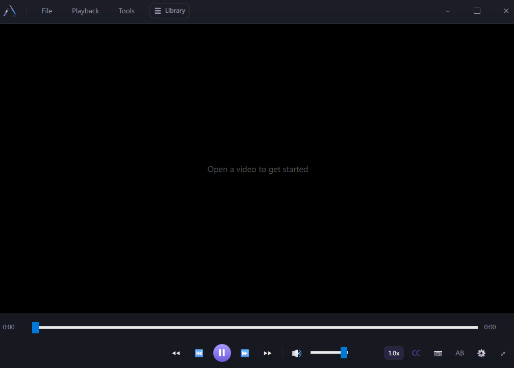

# Prism

A lightweight desktop video player for Windows, built with Qt6/QML and powered by libmpv.

## Features

- Smooth playback via mpv's rendering engine
- Playback speed control, subtitles, A/B loop
- Library panel for browsing and managing videos
- Clean, dark, minimal interface

## Building from source

See [BUILDING.md](BUILDING.md) for setup and build instructions.
